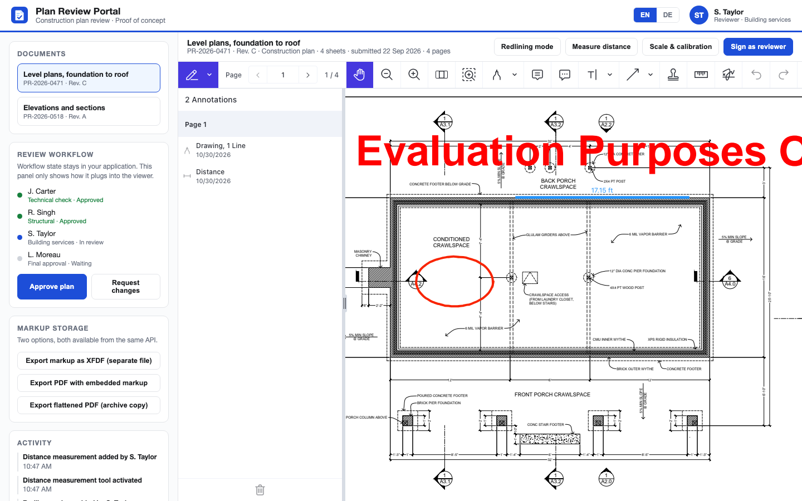
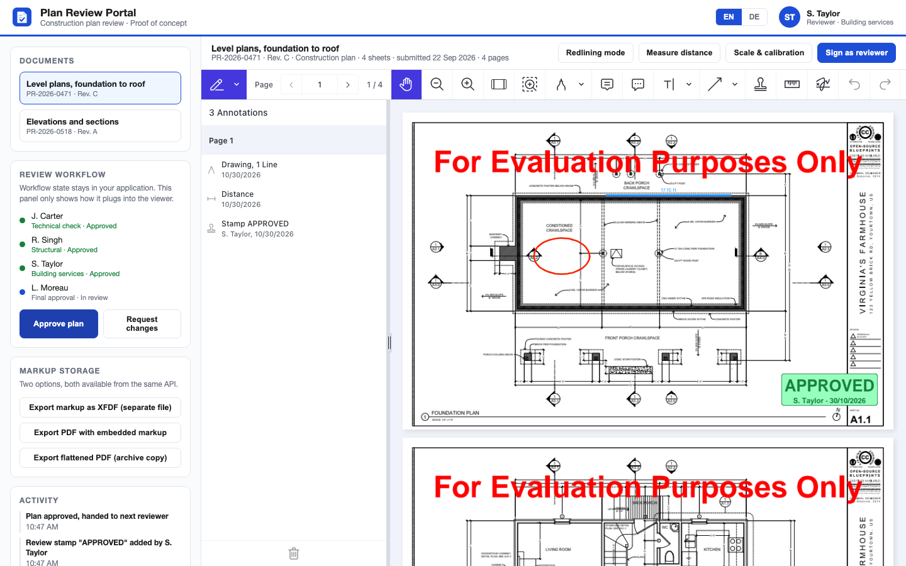

# Nutrient Plan Review

A Nutrient.io demo of a construction plan review portal in which a reviewer opens drawing sets, marks them up, measures on scaled sheets, signs and approves them, all in the browser.



1. **Viewer.** The Nutrient Web SDK renders CAD-exported PDF drawings in the browser with WebAssembly: thumbnails, pan, zoom, marquee zoom, search and print. There is no backend: the drawings never leave the machine they are opened on.
2. **Markup.** **Redlining mode** switches the viewer to a red pen. The toolbar has the other review tools: cloud, rectangle, ellipse, polygon, arrow, callout, text, note, highlighter, stamps and eraser. Every markup can carry a comment thread, and every markup carries the reviewer name (`annotationCreatorName`).
3. **Measurement.** Distance, perimeter and area tools report values in feet. The sheet scale (1/4 in = 1 ft-0 in) is configured per document and pre-selected (`measurementValueConfiguration`), snapping is on, and the calibration tool sets the scale of a drawing whose scale is unknown.
4. **Signature.** **Sign as reviewer** opens the electronic signature dialog: draw, type or upload an image.
5. **Workflow.** The review workflow panel is a mock-up of the host application's workflow. The app listens to the viewer events (`annotations.create`, `annotations.delete`) and lists them in **Activity**. **Approve plan** and **Request changes** place a review stamp and move the workflow to the next reviewer.
6. **Markup storage.** The same markup is exported as a separate XFDF file (`exportXFDF()`, the original PDF stays untouched), as a PDF with the markup embedded (`exportPDF()`), or flattened into the page for archiving (`exportPDF({ flatten: true })`).

Everything runs on the Nutrient Web SDK, bundled with Vite. Markup added after a document is signed does not break the signature, because it is written to a separate incremental section of the PDF.

## Prerequisites

- Node.js 20 or later and npm

## Environment variables

Copy `.env.example` to `.env`. Vite reads it at build time. The license key is only read from the environment, never from code.

| Variable | Purpose | Default |
|---|---|---|
| `VITE_NUTRIENT_LICENSE_KEY` | Nutrient Web SDK license key | empty = evaluation mode |
| `DEPLOY_BASE` | Sub-path the build is served from, for example `/plan-review/` | `/` |

In evaluation mode the viewer shows an evaluation watermark on every page. Everything else works.

## Build and run

```bash
npm install
```

```bash
cp .env.example .env
```

```bash
npm run dev
```

Open <http://localhost:5180>.

To build a static version in `dist/` and serve it locally:

```bash
npm run build
```

```bash
npm run preview
```

The build copies the Web SDK assets (`nutrient-viewer-lib`, WebAssembly and workers) from the `@nutrient-sdk/viewer` npm package next to the bundle, because they must be served from the app origin. They are not committed. The GdPicture WebAssembly files (`dist/nutrient-viewer-lib/gdpicture-*`, over 150 MB) are only used to convert Office documents and images. This demo only opens PDFs, so you can delete them from `dist/` before hosting the build.

## Using the app

About ten minutes, in this order:

1. **Open the portal.** The level plans are loaded. The reviewer identity is top right, and the workflow panel on the left shows where the review stands.
2. **Mark up the drawing.** Click **Redlining mode** and draw on the sheet. Then try the toolbar: cloud, arrow, callout, stamp. Open a comment on one of your markups and reply to it.
3. **Measure.** Click **Measure distance** and measure across a room. The value is in feet because the sheet scale is configured for the document. Open **Scale & calibration** to see the scale list and the calibration tool. The measurement menu of the toolbar also has perimeter and area tools.
4. **Sign.** Click **Sign as reviewer**, draw or type a signature and place it on the sheet.
5. **Decide.** Click **Approve plan**. A review stamp is placed on the sheet and the workflow panel moves to the next reviewer. **Activity** lists the events your application would store.

   

6. **Store the markup.** Export the markup as XFDF, then the PDF with embedded markup, then the flattened archive copy.
7. **Page through a set.** Switch to **Elevations and sections** and use the thumbnail sidebar.
8. **Language.** Switch **EN** to **DE** in the header. The viewer interface changes language at runtime (`instance.setLocale()`). German is an example: the Web SDK ships many interface languages.

## How this maps to an integration

- The viewer is a JavaScript library. It mounts into any container of your front end and takes a URL or an ArrayBuffer, so it sits next to your existing services without changing them.
- Markup is data. `exportXFDF()` returns the review layer as a standalone document you can version per reviewer and per review round. `exportPDF()` returns the PDF itself, with or without the markup flattened into the page.
- Every reviewer action raises an event with the creator name attached, which is what a workflow engine needs to advance a review step.

Not covered here, though supported by Nutrient: server-side processing (Document Engine), certificate-based digital signatures against your PKI, real-time collaboration between reviewers, and your own workflow, user management and document storage.

## Sample drawings

The two sample documents in `public/documents/` are extracted from a public drawing set by Open Source Blueprints, published on Wikimedia Commons under CC BY-SA 3.0. See [public/documents/CREDITS.md](public/documents/CREDITS.md). The reference numbers, dates and reviewer names shown around them in the app are fictitious (`src/documents.js`).

To review your own drawings, copy them to `public/documents/` and list them in `src/documents.js` with their drawing scale.

## Files

| Path | Content |
|---|---|
| `index.html` | Application shell: header, panels, viewer container |
| `src/main.js` | Viewer configuration, review actions, exports |
| `src/documents.js` | Sample documents, drawing scales and mock workflow |
| `src/styles.css` | Styling |
| `public/logo.svg` | Neutral app icon |
| `public/documents/` | Sample PDFs and their credits |
